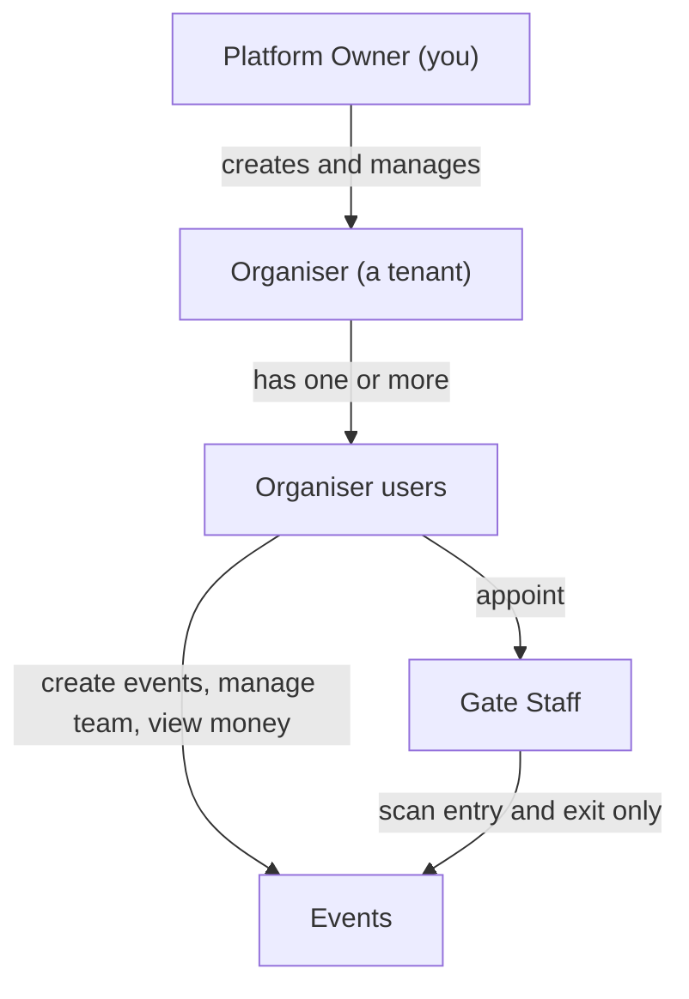
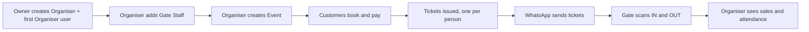
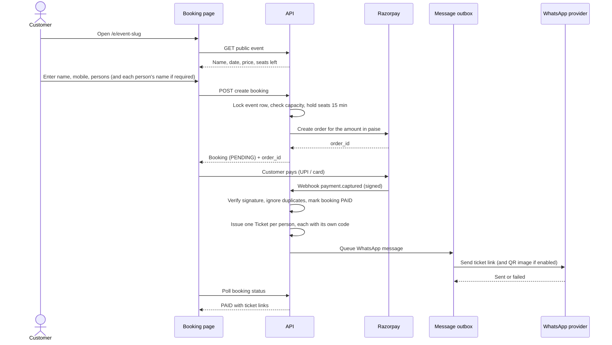
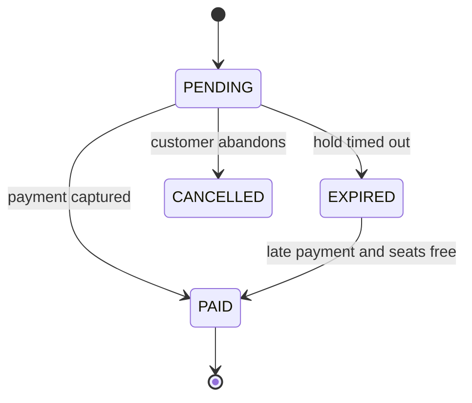
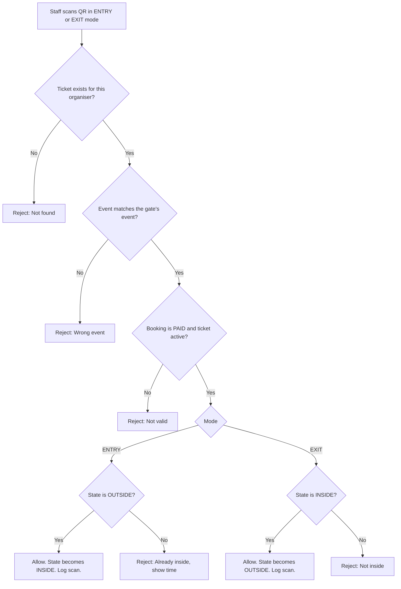
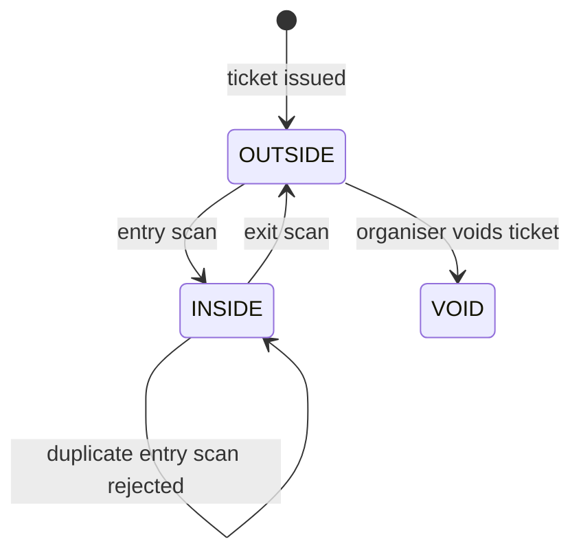
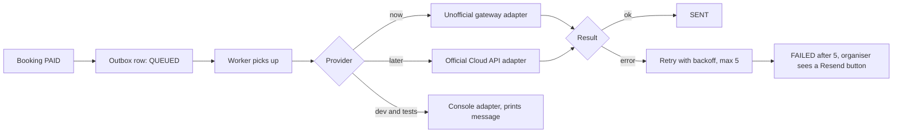
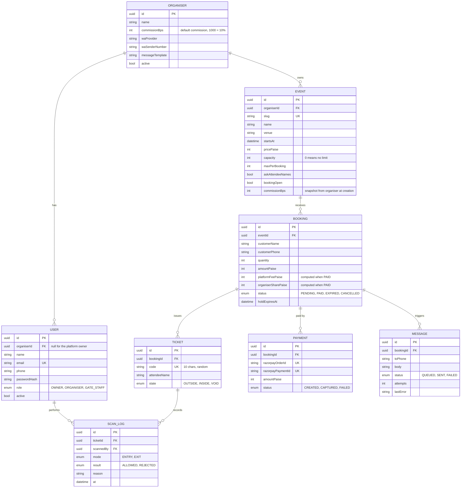
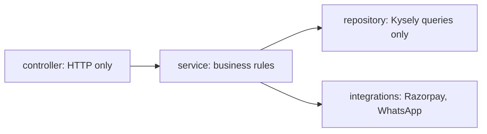

# Event Tickets: Product and Architecture Design

Status: **built (v1).** This document describes what the code in this repository does. Items marked _deferred_ are intentionally not built.

## 1. What we are building

A multi-organiser event ticketing platform. You are the platform owner. Organisers run their own events under your platform. Customers buy tickets online. At the venue, gate staff scan a QR code for **entry** and **exit**.

### Decisions locked

| Topic    | Decision                                                                                                                                  |
| -------- | ----------------------------------------------------------------------------------------------------------------------------------------- |
| Stack    | TypeScript (strict), Express 5, **Kysely** + PostgreSQL, zod. React (Vite) for the panel. Shared rules in `packages/shared`.              |
| Roles    | 3: Platform Owner, Organiser, Gate Staff                                                                                                  |
| Gate     | One QR **per person**. Entry scan. Exit scan with re-entry. Live count of people inside.                                                  |
| WhatsApp | Free (unofficial) gateway now, behind a provider interface so the official Cloud API can replace it later without touching business code. |
| Payments | Razorpay for collection. **Split and payouts are deferred** (section 9).                                                                  |

### Assumptions (change anything you disagree with)

- The platform owner's phone number (7498605559) is the owner's login and contact. The WhatsApp sender number is configured on the provider.
- Login is phone **or** email + password. Phone OTP can come later.
- Customers book as guests with name and mobile number. No customer accounts in v1.
- One ticket price per event in v1 (no VIP / early-bird tiers).
- Amounts are stored in **paise** (integers). Never floats.

---

## 2. Roles and permissions



| Capability                                   |    Platform Owner    |  Organiser   |      Gate Staff      |
| -------------------------------------------- | :------------------: | :----------: | :------------------: |
| Create / disable organisers                  |         Yes          |      No      |          No          |
| Set organiser commission %                   |         Yes          |      No      |          No          |
| See all organisers, all sales                |         Yes          |      No      |          No          |
| Create / edit events                         |    No (can view)     |     Yes      |          No          |
| Open / close bookings                        |          No          |     Yes      |          No          |
| View bookings and sales of own events        |      Yes (all)       |   Own only   |          No          |
| Add / disable gate staff and organiser users |          No          |     Yes      |          No          |
| WhatsApp and contact settings                | Platform number only | Own settings |          No          |
| Scan entry / exit                            |          No          |     Yes      |         Yes          |
| See live headcount inside                    |         Yes          |     Yes      | Yes (assigned event) |

**Tenancy rule:** every organiser query is scoped by `organiserId` from the session, never from the request body. The owner is the only role that can read across organisers.

---

## 3. Core business flow



---

## 4. Booking and payment

Seats are **held for 15 minutes** while the customer pays, so two buyers cannot take the last seat.



**Free events:** skip Razorpay. Booking becomes PAID immediately.
**Expired holds:** a scheduled job moves PENDING bookings older than 15 minutes to EXPIRED and frees the seats.
**Late payment on an expired hold:** if the webhook arrives after expiry and seats are still free, the booking is revived. If not, it is flagged `NEEDS_REFUND` for the organiser (refund handling is deferred).

### Booking states



---

## 5. Gate flow (entry, exit, re-entry)

Each **person** has their own ticket, QR and state. A booking for 4 people has 4 tickets, so 2 people can enter now and 2 later.

The QR contains a URL like `https://yourdomain/t/AB7K29XQ4M`. A phone camera opens the ticket page. The gate scanner reads the last part (the code).

The scanner has an explicit **ENTRY / EXIT mode switch**. This is safer than toggling, because an accidental double scan cannot flip a person's state.



### Ticket states



- Every scan, allowed or rejected, is written to `scan_logs` (who, when, mode, result). This is the audit trail.
- State changes use one atomic database update (`WHERE state = 'OUTSIDE'`), so two phones scanning the same ticket cannot both succeed.
- **Headcount inside** = tickets currently INSIDE for the event. Shown live on the scanner screen and the organiser dashboard.
- Entry window (for example only from 2 hours before start) is a per-event setting, off by default.

---

## 6. WhatsApp delivery

Business code never talks to a WhatsApp gateway directly. It writes a row to the **outbox**. A worker sends it through a **provider**. Switching from the free gateway to the official API means adding one provider class.



- Message template is editable per organiser with fields like `{{name}}`, `{{event}}`, `{{ticketUrl}}`. Unknown fields are rejected on save.
- One message per **booking**, containing a link per person (or all QR images if attach is on).
- Honest risk: unofficial gateways work by driving a normal WhatsApp account. WhatsApp can ban that number. Keep the sender number separate from your personal number. The outbox + provider design means moving to the official API later is a small change.

**What I need from you for the unofficial adapter:** request and response samples (URL, headers, JSON body) for: send text, send image, check connection status, get link QR, and the incoming-status webhook if any. Remove real keys before sending.

---

## 7. Data model



Commission is **recorded** (percent snapshot on the event, rupee amounts on the booking) but nothing is paid out automatically yet. See section 9.

Example: 2 tickets at ₹500 = ₹1,000. Commission 10%: platform ₹100, organiser ₹900 (before gateway fees).

---

## 8. Project structure

One repository (npm workspaces), three packages. Business rules that both the server and the UI need live once, in `packages/shared`.

```
event-tickets/
├── packages/
│   └── shared/src/                  # @et/shared: pure TypeScript, no I/O
│       ├── constants.ts             # roles, states, limits
│       ├── money.ts                 # splitCommission, formatINR
│       ├── ticket.ts                # decideScan (gate state machine), ticket codes
│       ├── booking.ts               # capacity, hold expiry, isEventOpen
│       ├── schemas.ts               # zod input schemas (server AND forms)
│       └── dto.ts                   # API response types
├── apps/
│   ├── api/
│   │   ├── src/
│   │   │   ├── main.ts              # starts the server, jobs, graceful shutdown
│   │   │   ├── app.ts               # composition root: wires everything
│   │   │   ├── config/env.ts        # env validated with zod
│   │   │   ├── db/                  # schema types, client, migrations, seed
│   │   │   ├── modules/             # one folder per business area
│   │   │   │   ├── auth/            # session, middleware, controller
│   │   │   │   ├── organisers/      # owner appoints organisers + commission
│   │   │   │   ├── users/           # gate staff
│   │   │   │   ├── events/
│   │   │   │   ├── bookings/        # booking, fulfilment (the one place a booking becomes PAID)
│   │   │   │   ├── tickets/
│   │   │   │   ├── gate/            # scan entry / exit, audit log
│   │   │   │   ├── payments/        # repository + Razorpay webhook
│   │   │   │   ├── messaging/       # outbox repository, worker service
│   │   │   │   ├── dashboard/
│   │   │   │   └── public/          # customer-facing routes
│   │   │   ├── integrations/
│   │   │   │   ├── payments/        # gateway interface, Razorpay, mock
│   │   │   │   └── whatsapp/        # provider interface, console provider
│   │   │   ├── jobs/                # tiny scheduler
│   │   │   └── shared/              # errors, http helpers, crypto, logger, clock
│   │   └── test/                    # integration tests on a real PostgreSQL
│   └── web/
│       └── src/
│           ├── app/                 # router, auth, shell
│           ├── features/            # auth, dashboard, events, organisers, team,
│           │                        # messages, gate, public (customer pages)
│           ├── components/          # shared UI only
│           ├── lib/api/             # Api interface: http.ts (real) + memory/ (demo)
│           ├── demo/                # demo-only control dock
│           └── styles/
├── docs/DESIGN.md                   # this file
├── .env.example
└── README.md
```

**Layering inside each API module** (the rule that keeps code clean):



- Controllers parse input (zod) and return output. No business logic.
- Services hold all rules and take an explicit `Actor`, so tenancy checks are testable without HTTP.
- Only repositories touch the database. They accept a transaction or the pool, so the same code runs in both.
- Integrations sit behind interfaces, so tests and the demo use fakes.
- `fulfilment.service` is the single place a booking becomes PAID (free booking, browser confirm and webhook all call it).

**Why Kysely and not Prisma:** the build sandbox could not download Prisma's engine binaries, so Prisma code could not be tested. Kysely is type-safe SQL with no engine download, so every query here is tested against real PostgreSQL. A Prisma port is possible later; only the repositories would change.

**Quality tooling:** TypeScript strict mode (+ `noUncheckedIndexedAccess`), ESLint + Prettier, zod for all input and env, Vitest + Supertest integration tests, pino logging, one `AppError` type, injected clock, SQL migrations.

**Concurrency rules** (all covered by tests): booking locks the event row (`FOR UPDATE`) so the last seat cannot be sold twice; settlement locks event, booking and payment in that order; a gate scan is an atomic `UPDATE … WHERE state = expected`; the WhatsApp outbox claims rows with `SKIP LOCKED`.

---

## 9. Deferred (kept out of v1 on purpose)

| Item                               | Why deferred                           | What is ready for it                                               |
| ---------------------------------- | -------------------------------------- | ------------------------------------------------------------------ |
| Razorpay split / organiser payouts | Needs your decision on the money model | Commission percent and rupee shares are already stored per booking |
| Official WhatsApp Cloud API        | You chose free for now                 | Provider interface                                                 |
| Refunds and cancellations          | Needs a policy                         | `NEEDS_REFUND` flag exists                                         |
| GST invoices                       | Needs CA input                         |                                                                    |
| Ticket tiers (VIP, early bird)     | Not requested                          | Add a `TicketType` table later                                     |
| Phone OTP login                    | Email login is enough                  |                                                                    |

When we discuss the money model, the choices are: collect everything in your Razorpay account and pay organisers yourself, Razorpay Route automatic split, or organiser's own Razorpay account with commission billed monthly. Route has eligibility rules and per-organiser KYC, so check eligibility with Razorpay before relying on it. Holding other people's money can carry compliance and tax duties, so confirm with a CA.

---

## 10. Minimal seed data

`npm run db:seed` (idempotent):

- 1 Platform Owner (7498605559, owner@example.com)
- 1 Organiser (10% commission) with its login, and 1 Gate Staff
- 1 live event (₹499, capacity 200) and 1 draft event (free)
- 1 PAID booking with 2 tickets

Passwords come from `SEED_PASSWORD` or are generated and printed once. Nothing is hard-coded.

---

## 11. Status

| Area                                                                                                               | State                                                                                  |
| ------------------------------------------------------------------------------------------------------------------ | -------------------------------------------------------------------------------------- |
| Roles, login, tenancy                                                                                              | Built, tested                                                                          |
| Organisers + per-event commission snapshot                                                                         | Built, tested                                                                          |
| Events: draft / publish / cancel (refund flag, tickets void)                                                       | Built, tested                                                                          |
| Booking: 15-min hold, no oversell, free events                                                                     | Built, tested                                                                          |
| Payments: mock gateway (tested), Razorpay gateway + signed webhook (webhook path tested with a stubbed order call) | Built. **Not yet run against live Razorpay**, needs your test keys                     |
| Gate: per-person QR, entry/exit/re-entry, audit log, headcount                                                     | Built, tested                                                                          |
| WhatsApp: outbox, retry/backoff, resend, console provider                                                          | Built, tested. **Real sending needs the gateway adapter** (needs your payload samples) |
| Panel: all three roles, responsive; customer booking + ticket pages                                                | Built                                                                                  |
| Payout split / settlement                                                                                          | _Deferred_ (amounts are tracked per booking)                                           |

## 12. Defaults taken for the open questions

1. 7498605559 is the owner's login and contact.
2. Commission is one percent per organiser, copied onto each event when it is created.
3. One ticket price per event.
4. Seat hold is 15 minutes.
5. Gate staff created by an organiser can scan that organiser's events; staff created by the owner can scan any.
6. Customers reach their tickets only through the WhatsApp link (it contains a private token).
